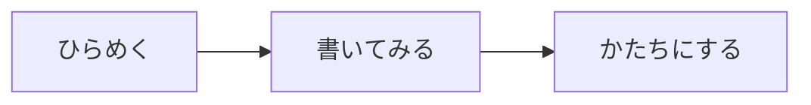

# 両忘

**書くことに、集中する。**

両忘は、ブラウザーで動くシンプルなMarkdownエディターです。
コードとプレビューを並べて、文章・図・数式・楽譜をひとつのノートにまとめられます。

配布用のHTMLファイルひとつで動作し、インストールやアカウント登録は不要です。描画ライブラリーと数式フォントを同梱しているため、基本機能は外部CDNに接続せずに使えます。

## 特徴

- **シンプルなUI**：書式アイコンを並べず、ファイル操作・表示切り替え・目次・テーマ・使い方を上部に集約。
- **3つの表示モード**：2ペイン、コードのみ、プレビューのみを切り替え。
- **キーボード中心の操作**：コマンドパレット、検索・置換、書式挿入、元に戻す・やり直す。
- **Markdownと拡張記法**：表、タスクリスト、脚注、定義リスト、目次などに対応。
- **Mermaid**：フローチャートやシーケンス図などをプレビュー。
- **LaTeX形式の数式**：KaTeXによるインライン・ブロック表示。
- **ABC記譜法**：テキストから五線譜を描画。
- **ライト／ダークモード**：選択したモードをブラウザー内に保存。
- **ローカル保存**：編集中のノートをブラウザー内に自動保存し、Markdownファイルとして書き出し。
- **レスポンシブ表示**：デスクトップでは左右、スマートフォン幅では上下にペインを配置。

## 使い始める

1. `yohaku.html`をダウンロードします。
2. ファイルをブラウザーで開きます。
3. サンプルを書き換えるか、上部の「新規」ボタンから書き始めます。
4. 必要な文章は「保存」ボタンからMarkdownファイルとして保存します。

> アプリ名は「両忘」ですが、配布ファイル名は`yohaku.html`です。

GitHub上のHTMLソース表示ではアプリは実行されません。ファイルをダウンロードして開いてください。

## 基本操作

### 表示と目次

上部の「2ペイン」「コード」「プレビュー」で表示を切り替えます。
デスクトップの2ペイン表示では、中央の境界をドラッグして幅を調整できます。

目次パネルから見出しへ移動できます。本文中に目次を表示したい場合は、独立した行に`[TOC]`または`[[toc]]`を記述します。

スクロール同期は、コードとプレビューのスクロール位置を**比率で対応させる方式**です。文章の行とプレビュー要素の厳密な対応ではありません。下部の「同期」から切り替えられます。

### 新規・開く・保存

- **新規**：空の`無題.md`を作成します。本文がある場合は「保存して新規作成」「保存せず新規作成」「キャンセル」を選べます。
- **開く**：Markdown・テキストファイルを読み込みます。ドラッグ＆ドロップにも対応しています。読み込み上限は3MBです。
- **保存**：現在の本文をMarkdownファイルとしてダウンロードします。ファイル名は上部の入力欄で変更できます。

「保存」はダウンロードによる書き出しであり、開いた元ファイルを直接上書きする機能ではありません。「保存して新規作成」を選んだ場合も、ダウンロードの完了はブラウザー側で確認してください。

現在扱えるノートはひとつです。新規作成やファイルを開く操作は、現在のノートを置き換えます。

### テーマ

上部の「ライト」「ダーク」ボタンで切り替えます。初回はブラウザーの明暗設定を参照し、以後は選択したモードを保存します。

Mermaidは図で指定された色との整合性と可読性を保つため、ダークモードでも図の内側は明るい背景を維持します。

## キーボードショートカット

表の`Mod`は、Windows／Linuxでは`Ctrl`、Macでは`⌘`です。`Alt`はMacでは`Option`に読み替えてください。

| 操作 | ショートカット |
| --- | --- |
| コマンドパレット | `Mod + K` |
| 新規作成 | `Mod + Alt + N` |
| ファイルを開く | `Mod + O` |
| Markdownを保存 | `Mod + S` |
| 2ペイン | `Mod + 1` |
| コードのみ | `Mod + 2` |
| プレビューのみ | `Mod + 3` |
| 目次パネル | `Mod + Shift + O` |
| ライト／ダーク切り替え | `Mod + Shift + L` |
| 太字 | `Mod + B` |
| 斜体 | `Mod + I` |
| リンクを挿入 | `Mod + Shift + K` |
| インラインコードを挿入 | `Mod + Shift + C` |
| 検索・置換パネルを開く | `Mod + F` |
| 元に戻す | `Mod + Z` |
| やり直す | `Mod + Shift + Z` |
| 字下げ／字下げを戻す | `Tab`／`Shift + Tab` |
| 使い方 | `F1` |
| ダイアログを閉じる | `Esc` |

コマンドパレットでは、文字を入力して操作を絞り込み、`↑`／`↓`で選択、`Enter`で実行できます。図・数式・楽譜・表などのひな形も挿入できます。

OSやブラウザー、拡張機能がショートカットを優先する環境では、画面上のボタンやコマンドパレットを利用してください。

## 対応する記法

見出し、段落、太字、斜体、引用、順序付き・順序なしリスト、区切り線、リンク、画像、インラインコード、コードブロックに加え、次の記法を扱えます。

| 記法 | 記述例 |
| --- | --- |
| 目次 | `[TOC]`または`[[toc]]` |
| 表 | パイプ区切りのMarkdownテーブル |
| 取り消し線 | `~~取り消し~~` |
| タスクリスト | `- [ ] 未完了`、`- [x] 完了` |
| 脚注 | `本文[^1]`と`[^1]: 脚注の内容` |
| 定義リスト | 用語の次の行に`: 説明` |
| 上付き／下付き | `x^2^`／`H~2~O` |
| マーカー | `==強調==` |
| HTML | 安全化処理を通した表示 |

Markdownのすべての方言や拡張構文に対応するものではありません。

### 目次

```markdown
# ノート

[TOC]

## 概要

## 詳細

### 補足
```

本文中の目次はレベル2〜6の見出しを対象とします。目次パネルではレベル1も含めて表示します。

### Mermaid

````markdown

````

### 数式

インライン数式は`$ … $`または`\( … \)`で記述します。

```markdown
オイラーの等式は $e^{i\pi}+1=0$ です。
```

ブロック数式は`$$ … $$`または`\[ … \]`で記述します。

```latex
$$
\int_{-\infty}^{\infty} e^{-x^2}\,dx = \sqrt{\pi}
$$
```

`math`・`latex`・`tex`を指定したコードブロックでも数式を表示できます。

````markdown
```math
x = \frac{-b \pm \sqrt{b^2-4ac}}{2a}
```
````

数式はKaTeXが対応するLaTeX構文の範囲です。LaTeX文書全体のコンパイルや、任意のパッケージ実行には対応しません。

### ABC記譜法

````markdown
```abc
X:1
T:小さなメロディー
M:4/4
L:1/4
K:C
C D E G | A G E D | C E G c | B G C2 |]
```
````

ABCは楽譜の表示のみです。音声再生は含みません。

## データの保存とプライバシー

- 本文の編集とプレビュー生成はブラウザー内で処理します。アプリから本文をサーバーへ送信する処理はありません。
- 現在の本文・ファイル名、表示モード、テーマはローカルストレージに保存します。
- ローカルストレージが使えない場合は、画面下部にファイル保存を促す表示が出ます。
- Markdown内の外部画像の読み込みや外部リンクのクリックでは、外部サイトへの通信が発生することがあります。
- HTMLとMermaidの描画結果にはDOMPurifyによる安全化処理を行っていますが、あらゆる入力に対する安全性を保証するものではありません。

**自動保存はバックアップではありません。** ブラウザーのデータ削除、保存容量の制限、プライベートモードなどに備え、大切な文章はMarkdownファイルとして保存してください。

特に`file://`で開く場合、ローカルストレージの扱いはブラウザーによって異なります。HTMLの名前や保存場所を変更した場合も、以前の自動保存内容を引き継げないことがあります。

## 制限・注意事項

- 複数ファイルのタブ管理、クラウド同期、共同編集はありません。
- UTF-8のMarkdown・テキストファイルを想定しています。文字コードの自動判定・変換は行いません。
- ローカル画像の相対パスは、開いたHTMLや配信元を基準に解決されます。別の場所にあるMarkdownファイルの隣の画像を、自動的に読み込む機能はありません。
- 外部画像を含むノートでは、オフライン時に画像が表示されない場合があります。
- 強制ダーク化する拡張機能などによって、アプリの配色が上書きされることがあります。
- モバイルの2ペインは上下分割です。境界のドラッグ調整はデスクトップ向けです。

## ビルド
JavaScript・CSS・KaTeXの数式フォントを埋め込んだhtmlファイルによって構成されているマス。

| ファイル | 用途 |
| --- | --- |
| `app.js` | エディター、Markdown解析、描画、各操作 |
| `shell.html` | 画面構造とダイアログ |
| `style.css` | 基本スタイル |
| `mobile.css` | モバイル向けの調整 |
| `color-guard.css` | テーマと表示調整 |
| `build.mjs` | 単一HTMLへのビルド |
| `package.json`／`package-lock.json` | 開発用依存関係 |
| `yohaku.html` | 配布用HTML |

### 主な使用ライブラリー

| ライブラリー | 用途 |
| --- | --- |
| CodeMirror 6 | コード編集、検索、履歴、キー操作 |
| markdown-itと各種プラグイン | Markdown解析と拡張記法 |
| Mermaid | 図表の描画 |
| KaTeX | 数式の描画 |
| abcjs | ABC記譜法の描画 |
| DOMPurify | HTML・SVGの安全化 |
| esbuild | JavaScriptのバンドル |
