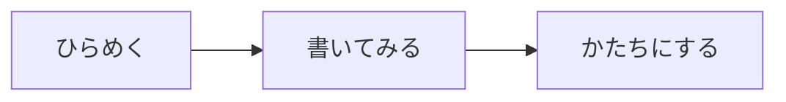

# 考えを、そのまま。

書くことに集中するための、小さなMarkdownエディター。
文章も、図も、数式も、音楽も。この一枚に。

[TOC]

## 書く、組み立てる

**太字**、*斜体*、~~取り消し線~~、==マーカー==。
リンクや表、脚注も、いつもの記法で書けます。[^note]

| 書きたいもの | 記法 |
| :--- | :--- |
| 図とフロー | Mermaid |
| 数式 | LaTeX / KaTeX |
| 楽譜 | ABC記譜法 |

- [x] まずは、書き始める
- [ ] 自分のアイデアを加える

## アイデアをつなぐ



## 数式を添える

インライン数式は $e^{i\pi}+1=0$ のように。
ブロック数式は独立した行に表示できます。

$$
\int_{-\infty}^{\infty} e^{-x^2}\,dx = \sqrt{\pi}
$$

## 音楽を書く

```abc
X:1
T:小さなメロディー
M:4/4
L:1/4
K:C
C D E G | A G E D | C E G c | B G C2 |]
```

## 記法のメモ

> キーボードから手を離さずに。
> **Ctrl / ⌘ + K** で、すべての操作を探せます。

```javascript
const idea = 'ここから、はじめよう';
console.log(idea);
```

用語
: 定義リストも使えます。

H~2~O と x^2^。区切り線、画像、引用、入れ子のリストにも対応。

[^note]: この文章はサンプルです。自由に書き換えてください。
